# System Design: Sistem Peminjaman & Inventaris Barang Tim IT

| | |
|---|---|
| **Versi** | 1.3 (mengikuti PRD v5.3) |
| **Basis data** | MySQL (InnoDB). Lihat bagian 6 dan 6A |
| **Tanggal** | 12 Oktober 2026 |
| **Dokumen induk** | [`PRD.md`](PRD.md). Kode `BR-xx`, `FR-xx`, dan `D-x` merujuk ke sana. |

Diagram memakai Mermaid, sehingga tampil langsung di GitHub dan editor Markdown yang mendukungnya.

---

## 1. Arsitektur

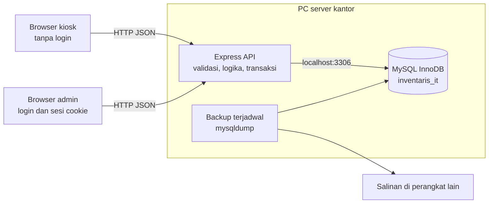

Tiga prinsip yang menentukan hampir semua keputusan berikutnya:

1. **Server adalah satu-satunya pemilik logika.** Frontend tidak menghitung stok, tidak memutuskan boleh/tidaknya klaim, dan tidak menyimpan rahasia (FR-S-01).
2. **Satu operasi tulis = satu transaksi.** Pengecekan dan perubahan terjadi dalam transaksi yang sama (transaksi InnoDB dengan penguncian baris), sehingga dua kiosk tidak bisa saling menimpa.
3. **Stok punya buku besar.** Setiap perubahan `total`, `tersedia`, atau `rusak` menghasilkan satu baris di `stock_movements` (FR-S-02). Angka di tabel `items` adalah ringkasan yang selalu bisa diverifikasi ulang dari buku besar.

## 2. Model stok

### 2.1 Perjalanan unit barang

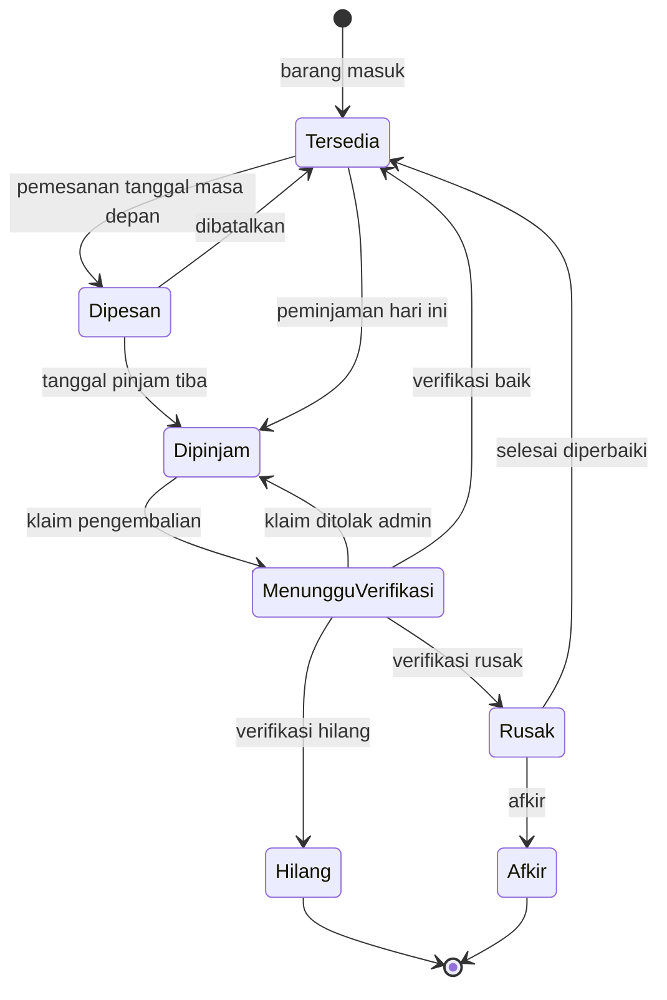

### 2.2 Bagaimana keadaan itu disimpan

Hanya tiga keadaan yang disimpan sebagai angka di `items`. Dua lainnya dihitung dari data peminjaman:

| Keadaan | Sumber |
|---|---|
| `tersedia` | Kolom `items.tersedia` |
| `rusak` | Kolom `items.rusak` |
| `total` | Kolom `items.total` (berkurang saat hilang atau afkir) |
| Menunggu Verifikasi | `SUM(return_claim_lines.qty)` pada klaim berstatus `menunggu` |
| Dipinjam (termasuk Dipesan) | `qty_dipinjam − menunggu − terverifikasi(baik+rusak+hilang)` per `loan_items`, pada peminjaman yang belum dibatalkan. Dipesan = `tanggal_pinjam > hari_ini`, tanpa penghitung terpisah |

Invarian (BR-01) yang diperiksa tes otomatis dan pemeriksaan kesehatan saat server menyala:

```
tersedia + rusak + dipinjam + menunggu_verifikasi = total      (semua ≥ 0, dipinjam sudah termasuk dipesan)
items.total      = SUM(stock_movements.delta_total)
items.tersedia   = SUM(stock_movements.delta_tersedia)
items.rusak      = SUM(stock_movements.delta_rusak)
```

### 2.3 Efek setiap operasi

| Operasi | `total` | `tersedia` | `rusak` | Jenis di buku besar |
|---|---|---|---|---|
| Barang baru / tambah stok | +n | +n | — | `TAMBAH_STOK` |
| Kurangi stok (koreksi) | −n | −n | — | `KURANG_STOK` |
| Peminjaman atau pemesanan dibuat | — | −n | — | `PINJAM` |
| Koreksi jumlah pinjaman | — | ±n | — | `KOREKSI_PINJAM` |
| Peminjaman dibatalkan (peminjam atau admin) | — | +n | — | `BATAL_PINJAM` |
| Klaim pengembalian dikirim | — | — | — | *(tidak ada, BR-03)* |
| Verifikasi: baik | — | +n | — | `VERIFIKASI_BAIK` |
| Verifikasi: rusak | — | — | +n | `VERIFIKASI_RUSAK` |
| Verifikasi: hilang | −n | — | — | `VERIFIKASI_HILANG` |
| Verifikasi: ditolak | — | — | — | *(unit kembali ke Dipinjam)* |
| Selesai diperbaiki | — | +n | −n | `PERBAIKAN_SELESAI` |
| Afkir | −n | — | −n | `AFKIR` |

## 3. Status peminjaman (turunan)

Status tidak disimpan, melainkan dihitung dari dua angka per peminjaman: **O** = unit belum diklaim, **P** = unit menunggu verifikasi.

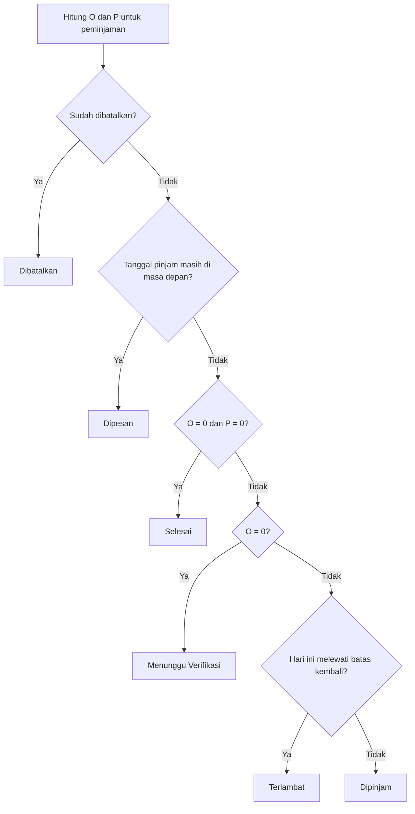

Lencana tambahan dihitung terpisah dan boleh tampil bersamaan dengan status utama:

| Lencana | Syarat |
|---|---|
| Sebagian | Ada unit yang sudah diklaim atau diverifikasi, tetapi O > 0 |
| Ada klaim menunggu | P > 0 |
| Diperpanjang n× | Ada n baris di `loan_extensions` |
| Ada catatan | Ada klaim dengan `catatan_peminjam` tidak kosong, atau `catatan_admin` tidak kosong |

**Hari terlambat** (BR-10):

- Untuk peminjaman dengan O > 0: `MAX(0, hari_ini − batas_kembali)`.
- Untuk klaim: nilai yang dibekukan di `return_claims.hari_terlambat` pada saat klaim dikirim.
- Untuk peminjaman dengan O = 0 dan P > 0, keterlambatan tidak bertambah selama menunggu verifikasi (D-8).

## 4. Alur kerja

### 4.1 Peminjaman (kiosk)

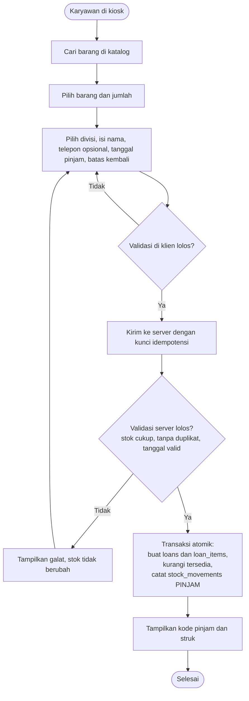

Bila tanggal pinjam di masa depan, peminjaman dibuat dengan alur yang sama dan stok **langsung ditahan** (D-10). Bedanya hanya pada tampilan (status Dipesan) dan hak: pemesanan tidak dapat diklaim atau diperpanjang, tetapi dapat dibatalkan (alur 4.9).

### 4.2 Cek peminjaman dan batas waktu

Halaman ini menjadi **pintu masuk tunggal** untuk pengembalian dan perpanjangan.

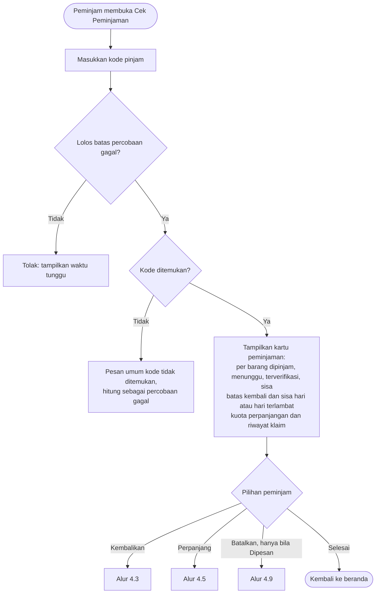

### 4.3 Klaim pengembalian parsial (kiosk)

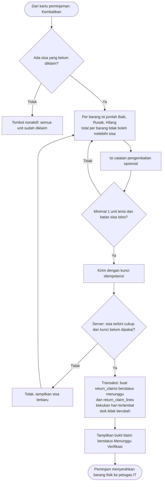

### 4.4 Verifikasi (admin)

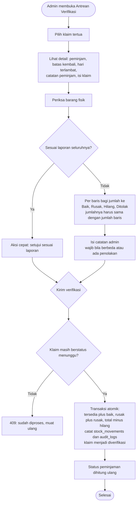

### 4.5 Perpanjangan

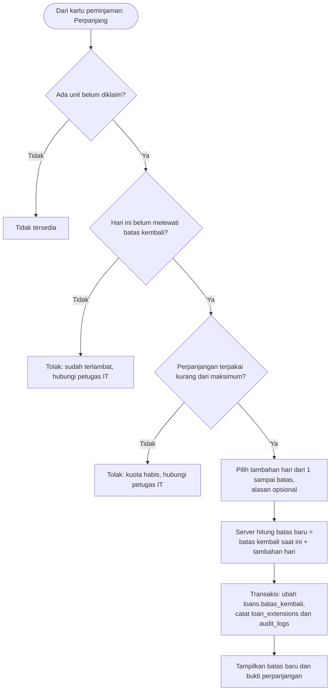

Jalur admin (BR-13) memakai endpoint terpisah dan melewati pemeriksaan B sampai D, tetapi mewajibkan alasan.

### 4.6 Stok rusak: perbaikan dan afkir (admin)

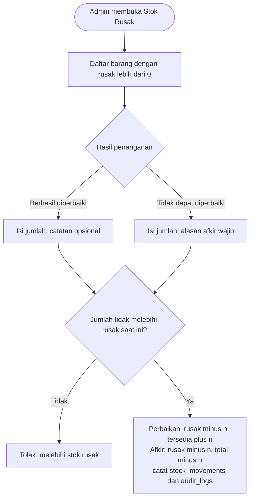

### 4.7 Login admin dan sesi

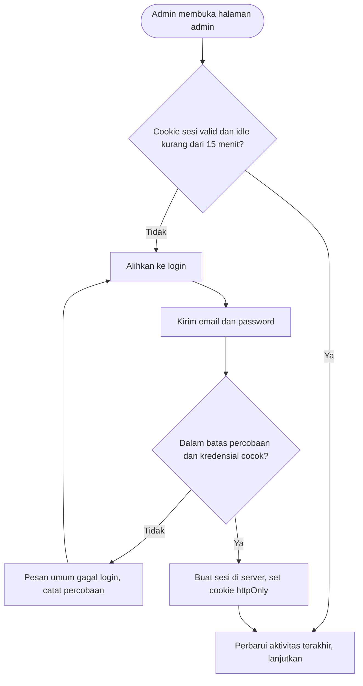

### 4.8 Urutan end-to-end: dari klaim sampai verifikasi

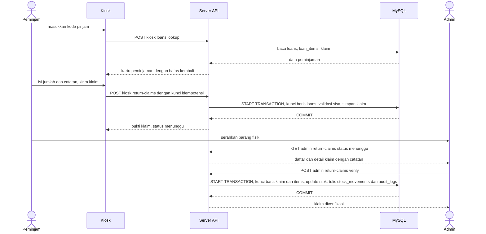

### 4.9 Pembatalan pemesanan atau peminjaman

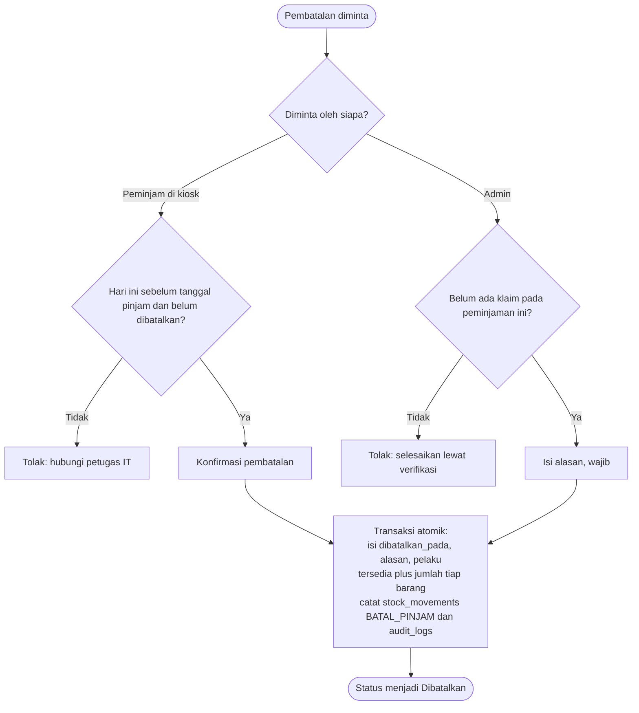

## 5. Relasi database (ERD)

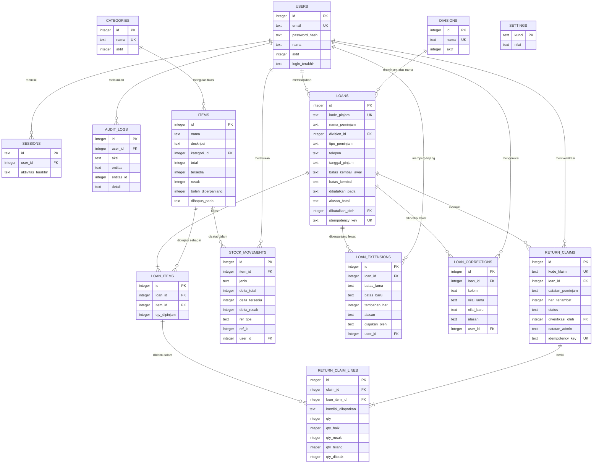

Catatan membaca ERD:

- `RETURN_CLAIM_LINES` menyimpan **dua hal**: apa yang dilaporkan peminjam (`kondisi_dilaporkan`, `qty`) dan apa hasil verifikasi admin (`qty_baik`, `qty_rusak`, `qty_hilang`, `qty_ditolak`, kosong sebelum diverifikasi). Satu baris laporan dapat dipecah admin ke beberapa hasil.
- `user_id` di `STOCK_MOVEMENTS`, `LOAN_EXTENSIONS`, dan `AUDIT_LOGS` bernilai `NULL` untuk aksi yang datang dari kiosk.
- `SETTINGS` berdiri sendiri (tanpa relasi), berisi parameter di PRD bagian 8.
- `LOANS.dibatalkan_oleh` bernilai `NULL` bila pembatalan dilakukan peminjam di kiosk. Status Dipesan tidak disimpan, melainkan diturunkan dari `tanggal_pinjam > hari_ini`.
- `LOANS.tipe_peminjam` adalah `ENUM('karyawan','magang')` (huruf kecil agar konsisten dengan ENUM lain; label tampilan tetap Karyawan dan Magang), wajib diisi dari kiosk. Tidak memengaruhi kuota atau durasi (BR-30).
- `ITEMS.kategori_id` adalah FK ke `categories.id`, wajib (NOT NULL). Karena `items.kategori_id` NOT NULL, baris categories "Tanpa Kategori" dibuat oleh seed saat inisialisasi basis data. Kondisi barang (Baik/Sebagian rusak/Semua rusak) diturunkan dari angka stok saat dibaca, tidak disimpan (BR-29).
- `CATEGORIES` berperilaku sejajar dengan `DIVISIONS`: nonaktifkan, tidak hapus, agar riwayat tetap terbaca (BR-28).
- Tipe data pada ERD bersifat logis. Tipe sebenarnya (`INT`, `VARCHAR`, `DATE`, `DATETIME`, `ENUM`) ada di bagian 6.

## 6. Skema SQL (MySQL)

Skema ini menjadi isi `db/migrations/0001_init.sql`. Skema sudah dijalankan dan diuji pada MariaDB 10.11 (semua `CHECK`, indeks unik untuk soft-delete, dan penolakan pelanggaran). **Jalankan ulang pada MySQL Laragon yang dipakai** (task 0.5 dan 1.2), karena MariaDB dan MySQL sedikit berbeda.

```sql
-- Skema MySQL 8.0.16+ (atau MariaDB 10.2.1+) untuk Sistem Peminjaman & Inventaris Tim IT
-- Mengikuti PRD v5.3. Semua timestamp disimpan UTC. Semua tanggal (DATE) memakai tanggal kalender Asia/Jakarta.

CREATE TABLE users (
  id             INT NOT NULL AUTO_INCREMENT PRIMARY KEY,
  email          VARCHAR(190) NOT NULL,
  password_hash  VARCHAR(255) NOT NULL,
  nama           VARCHAR(100) NOT NULL,
  aktif          TINYINT(1) NOT NULL DEFAULT 1,
  dibuat_pada    DATETIME NOT NULL DEFAULT CURRENT_TIMESTAMP,
  login_terakhir DATETIME NULL,
  UNIQUE KEY ux_users_email (email),                 -- collation _ci membuat unik tanpa peduli huruf besar/kecil
  CONSTRAINT ck_users_aktif CHECK (aktif IN (0,1))
) ENGINE=InnoDB;

CREATE TABLE sessions (
  id                 CHAR(64) NOT NULL PRIMARY KEY,  -- hash SHA-256 token sesi (hex), bukan token mentah
  user_id            INT NOT NULL,
  dibuat_pada        DATETIME NOT NULL DEFAULT CURRENT_TIMESTAMP,
  aktivitas_terakhir DATETIME NOT NULL DEFAULT CURRENT_TIMESTAMP,
  CONSTRAINT fk_sessions_user FOREIGN KEY (user_id) REFERENCES users(id)
) ENGINE=InnoDB;

CREATE TABLE divisions (
  id    INT NOT NULL AUTO_INCREMENT PRIMARY KEY,
  nama  VARCHAR(100) NOT NULL,
  aktif TINYINT(1) NOT NULL DEFAULT 1,                -- dinonaktifkan, tidak dihapus (BR-27)
  UNIQUE KEY ux_divisions_nama (nama),
  CONSTRAINT ck_divisions_aktif CHECK (aktif IN (0,1))
) ENGINE=InnoDB;

CREATE TABLE categories (
  id    INT NOT NULL AUTO_INCREMENT PRIMARY KEY,
  nama  VARCHAR(100) NOT NULL,
  aktif TINYINT(1) NOT NULL DEFAULT 1,                -- dinonaktifkan, tidak dihapus (BR-28)
  UNIQUE KEY ux_categories_nama (nama),
  CONSTRAINT ck_categories_aktif CHECK (aktif IN (0,1))
) ENGINE=InnoDB;

CREATE TABLE items (
  id                 INT NOT NULL AUTO_INCREMENT PRIMARY KEY,
  nama               VARCHAR(150) NOT NULL,
  deskripsi          TEXT NULL,
  kategori_id        INT NOT NULL,                    -- wajib (BR-28); FK ke categories.id (baris "Tanpa Kategori" dibuat seed)
  total              INT NOT NULL,
  tersedia           INT NOT NULL,
  rusak              INT NOT NULL DEFAULT 0,
  boleh_diperpanjang TINYINT(1) NOT NULL DEFAULT 1,   -- D-12
  dibuat_pada        DATETIME NOT NULL DEFAULT CURRENT_TIMESTAMP,
  diubah_pada        DATETIME NOT NULL DEFAULT CURRENT_TIMESTAMP ON UPDATE CURRENT_TIMESTAMP,
  dihapus_pada       DATETIME NULL,                   -- soft-delete
  -- MySQL tidak punya indeks parsial. Kolom turunan ini bernilai NULL untuk barang terhapus,
  -- sehingga nama hanya harus unik di antara barang aktif.
  nama_aktif         VARCHAR(150) GENERATED ALWAYS AS (IF(dihapus_pada IS NULL, nama, NULL)) STORED,
  UNIQUE KEY ux_items_nama_aktif (nama_aktif),
  KEY ix_items_kategori (kategori_id),
  CONSTRAINT fk_items_kategori FOREIGN KEY (kategori_id) REFERENCES categories(id),
  CONSTRAINT ck_items_total    CHECK (total >= 0),
  CONSTRAINT ck_items_tersedia CHECK (tersedia >= 0),
  CONSTRAINT ck_items_rusak    CHECK (rusak >= 0),
  CONSTRAINT ck_items_bucket   CHECK (tersedia + rusak <= total),   -- sisanya = dipinjam + menunggu
  CONSTRAINT ck_items_boleh    CHECK (boleh_diperpanjang IN (0,1))
) ENGINE=InnoDB;

CREATE TABLE loans (
  id                 INT NOT NULL AUTO_INCREMENT PRIMARY KEY,
  kode_pinjam        VARCHAR(12) NOT NULL,            -- huruf besar, dinormalkan oleh aplikasi
  nama_peminjam      VARCHAR(100) NOT NULL,
  division_id        INT NOT NULL,
  tipe_peminjam      ENUM('karyawan','magang') NOT NULL,  -- wajib (BR-30); konsisten huruf kecil, label Karyawan/Magang
  telepon            VARCHAR(20) NULL,
  tanggal_pinjam     DATE NOT NULL,
  batas_kembali_awal DATE NOT NULL,
  batas_kembali      DATE NOT NULL,                   -- berubah saat diperpanjang
  idempotency_key    CHAR(36) NULL,
  dibuat_pada        DATETIME NOT NULL DEFAULT CURRENT_TIMESTAMP,
  dibatalkan_pada    DATETIME NULL,                   -- terisi = Dibatalkan (BR-24, BR-25)
  alasan_batal       VARCHAR(500) NULL,
  dibatalkan_oleh    INT NULL,                        -- NULL bila peminjam
  UNIQUE KEY ux_loans_kode (kode_pinjam),
  UNIQUE KEY ux_loans_idem (idempotency_key),
  KEY ix_loans_batas (batas_kembali),
  KEY ix_loans_tipe (tipe_peminjam),
  CONSTRAINT fk_loans_division FOREIGN KEY (division_id)     REFERENCES divisions(id),
  CONSTRAINT fk_loans_batal    FOREIGN KEY (dibatalkan_oleh) REFERENCES users(id),
  CONSTRAINT ck_loans_tanggal  CHECK (batas_kembali >= tanggal_pinjam)
) ENGINE=InnoDB;

CREATE TABLE loan_items (
  id           INT NOT NULL AUTO_INCREMENT PRIMARY KEY,
  loan_id      INT NOT NULL,
  item_id      INT NOT NULL,
  qty_dipinjam INT NOT NULL,
  UNIQUE KEY ux_loan_items (loan_id, item_id),        -- BR-22
  CONSTRAINT fk_li_loan FOREIGN KEY (loan_id) REFERENCES loans(id),
  CONSTRAINT fk_li_item FOREIGN KEY (item_id) REFERENCES items(id),
  CONSTRAINT ck_li_qty  CHECK (qty_dipinjam >= 1)
) ENGINE=InnoDB;

CREATE TABLE return_claims (
  id                INT NOT NULL AUTO_INCREMENT PRIMARY KEY,
  kode_klaim        VARCHAR(12) NOT NULL,
  loan_id           INT NOT NULL,
  catatan_peminjam  VARCHAR(500) NULL,
  diklaim_pada      DATETIME NOT NULL DEFAULT CURRENT_TIMESTAMP,
  hari_terlambat    INT NOT NULL DEFAULT 0,           -- dibekukan saat klaim, BR-10
  status            ENUM('menunggu','diverifikasi') NOT NULL DEFAULT 'menunggu',
  diverifikasi_oleh INT NULL,
  diverifikasi_pada DATETIME NULL,
  catatan_admin     VARCHAR(500) NULL,
  idempotency_key   CHAR(36) NULL,
  UNIQUE KEY ux_claims_kode (kode_klaim),
  UNIQUE KEY ux_claims_idem (idempotency_key),
  KEY ix_claims_loan (loan_id),
  KEY ix_claims_status (status, diklaim_pada),
  CONSTRAINT fk_claims_loan FOREIGN KEY (loan_id)           REFERENCES loans(id),
  CONSTRAINT fk_claims_user FOREIGN KEY (diverifikasi_oleh) REFERENCES users(id),
  CONSTRAINT ck_claims_hari CHECK (hari_terlambat >= 0)
) ENGINE=InnoDB;

CREATE TABLE return_claim_lines (
  id                 INT NOT NULL AUTO_INCREMENT PRIMARY KEY,
  claim_id           INT NOT NULL,
  loan_item_id       INT NOT NULL,
  kondisi_dilaporkan ENUM('baik','rusak','hilang') NOT NULL,
  qty                INT NOT NULL,
  -- hasil verifikasi: kosong semua sebelum diverifikasi, terisi semua sesudahnya
  qty_baik           INT NULL,
  qty_rusak          INT NULL,
  qty_hilang         INT NULL,
  qty_ditolak        INT NULL,
  UNIQUE KEY ux_lines (claim_id, loan_item_id, kondisi_dilaporkan),
  KEY ix_lines_loan_item (loan_item_id),
  CONSTRAINT fk_lines_claim     FOREIGN KEY (claim_id)     REFERENCES return_claims(id),
  CONSTRAINT fk_lines_loan_item FOREIGN KEY (loan_item_id) REFERENCES loan_items(id),
  CONSTRAINT ck_lines_qty   CHECK (qty >= 1),
  CONSTRAINT ck_lines_hasil CHECK (
    (qty_baik IS NULL AND qty_rusak IS NULL AND qty_hilang IS NULL AND qty_ditolak IS NULL)
    OR (qty_baik >= 0 AND qty_rusak >= 0 AND qty_hilang >= 0 AND qty_ditolak >= 0
        AND qty_baik + qty_rusak + qty_hilang + qty_ditolak = qty))               -- BR-05
) ENGINE=InnoDB;

CREATE TABLE loan_extensions (
  id            INT NOT NULL AUTO_INCREMENT PRIMARY KEY,
  loan_id       INT NOT NULL,
  batas_lama    DATE NOT NULL,
  batas_baru    DATE NOT NULL,
  tambahan_hari INT NOT NULL,
  alasan        VARCHAR(500) NULL,
  diajukan_oleh ENUM('peminjam','admin') NOT NULL,
  user_id       INT NULL,                             -- NULL bila peminjam
  dibuat_pada   DATETIME NOT NULL DEFAULT CURRENT_TIMESTAMP,
  KEY ix_ext_loan (loan_id),
  CONSTRAINT fk_ext_loan FOREIGN KEY (loan_id) REFERENCES loans(id),
  CONSTRAINT fk_ext_user FOREIGN KEY (user_id) REFERENCES users(id),
  CONSTRAINT ck_ext_hari CHECK (tambahan_hari >= 1)
) ENGINE=InnoDB;

CREATE TABLE loan_corrections (
  id          INT NOT NULL AUTO_INCREMENT PRIMARY KEY,
  loan_id     INT NOT NULL,
  kolom       VARCHAR(50) NOT NULL,
  nilai_lama  VARCHAR(500) NULL,
  nilai_baru  VARCHAR(500) NULL,
  alasan      VARCHAR(500) NOT NULL,                  -- BR-16
  user_id     INT NOT NULL,
  dibuat_pada DATETIME NOT NULL DEFAULT CURRENT_TIMESTAMP,
  KEY ix_corr_loan (loan_id),
  CONSTRAINT fk_corr_loan FOREIGN KEY (loan_id) REFERENCES loans(id),
  CONSTRAINT fk_corr_user FOREIGN KEY (user_id) REFERENCES users(id)
) ENGINE=InnoDB;

CREATE TABLE stock_movements (
  id             INT NOT NULL AUTO_INCREMENT PRIMARY KEY,
  item_id        INT NOT NULL,
  jenis          ENUM('TAMBAH_STOK','KURANG_STOK','PINJAM','KOREKSI_PINJAM','BATAL_PINJAM',
                      'VERIFIKASI_BAIK','VERIFIKASI_RUSAK','VERIFIKASI_HILANG',
                      'PERBAIKAN_SELESAI','AFKIR') NOT NULL,
  delta_total    INT NOT NULL DEFAULT 0,
  delta_tersedia INT NOT NULL DEFAULT 0,
  delta_rusak    INT NOT NULL DEFAULT 0,
  ref_tipe       VARCHAR(30) NULL,                    -- 'loan' | 'return_claim' | ...
  ref_id         INT NULL,
  user_id        INT NULL,                            -- NULL untuk aksi kiosk
  catatan        VARCHAR(500) NULL,
  dibuat_pada    DATETIME NOT NULL DEFAULT CURRENT_TIMESTAMP,
  KEY ix_mov_item (item_id, dibuat_pada),
  CONSTRAINT fk_mov_item FOREIGN KEY (item_id) REFERENCES items(id),
  CONSTRAINT fk_mov_user FOREIGN KEY (user_id) REFERENCES users(id)
) ENGINE=InnoDB;

CREATE TABLE audit_logs (
  id          INT NOT NULL AUTO_INCREMENT PRIMARY KEY,
  user_id     INT NULL,
  aksi        VARCHAR(60) NOT NULL,
  entitas     VARCHAR(60) NOT NULL,
  entitas_id  INT NULL,
  detail      JSON NULL,
  dibuat_pada DATETIME NOT NULL DEFAULT CURRENT_TIMESTAMP,
  KEY ix_audit_entitas (entitas, entitas_id),
  CONSTRAINT fk_audit_user FOREIGN KEY (user_id) REFERENCES users(id)
) ENGINE=InnoDB;

CREATE TABLE settings (
  kunci       VARCHAR(60) NOT NULL PRIMARY KEY,
  nilai       VARCHAR(255) NOT NULL,
  diubah_pada DATETIME NOT NULL DEFAULT CURRENT_TIMESTAMP ON UPDATE CURRENT_TIMESTAMP
) ENGINE=InnoDB;
```

Tiga hal yang `CHECK` tidak bisa jamin sendiri, sehingga harus dijaga kode dan tes: (1) keempat kolom hasil verifikasi terisi semuanya atau kosong semuanya, (2) `klaim ≤ sisa` pada BR-04, yang bergantung pada baris lain, dan (3) versi server: MySQL sebelum 8.0.16 menerima sintaks `CHECK` tetapi **mengabaikannya diam-diam**, jadi pemeriksaan versi saat start (bagian 6A.4) wajib.

Perbedaan MySQL yang perlu diketahui pengembang:

| Hal | Di MySQL |
|---|---|
| Indeks unik parsial (nama barang aktif) | Tidak didukung. Dipakai kolom turunan `nama_aktif` yang bernilai `NULL` untuk barang terhapus |
| Huruf besar/kecil | Collation `utf8mb4_unicode_ci` tidak membedakan huruf besar/kecil, sehingga `pjm-ab12cd` cocok dengan `PJM-AB12CD`. Tetap normalkan kode ke huruf besar di aplikasi |
| Tanggal | `DATE` untuk tanggal kalender, `DATETIME` untuk waktu kejadian (UTC). Driver wajib memakai `dateStrings` (bagian 6A.4) |
| Nilai bawaan waktu | `CURRENT_TIMESTAMP` mengikuti zona waktu sesi, karena itu zona waktu server diset ke `+00:00` |
| Teks panjang | `VARCHAR(n)` menegakkan batas panjang (mis. 500 karakter) hanya dalam mode strict |
| Perintah DDL | Tidak dapat dibatalkan dengan `ROLLBACK` (bagian 6A.5) |

## 6A. Pengelolaan basis data

### 6A.1 Keputusan dan batasan

- **Satu mesin basis data:** MySQL InnoDB (D-13). Tidak ada mode ganda SQLite/MySQL, karena itu menggandakan pengujian. `database.sqlite` hanya menjadi sumber migrasi (bagian 11) dan arsip.
- **Versi minimum:** MySQL 8.0.16 atau MariaDB 10.2.1. Periksa dengan `SELECT VERSION();` pada Laragon yang dipakai. Server aplikasi menolak menyala bila versinya lebih rendah.
- **MySQL berjalan di PC yang sama dengan aplikasi** dan tidak menerima koneksi dari jaringan.
- **Laragon dan PC server.** Laragon dirancang sebagai lingkungan pengembangan. Untuk PC server kantor, syaratnya hanya dua: MySQL menyala otomatis setelah PC hidup, dan tidak ada yang bergantung pada jendela Laragon yang terbuka. Pilihannya: (a) Laragon dengan mulai-otomatis, atau (b) MySQL Server resmi sebagai layanan Windows. Untuk server kantor (b) lebih tenang; untuk laptop pengembang (a) cukup. Apa pun pilihannya, buktikan dengan restart PC sungguhan.

### 6A.2 Lingkungan

| Lingkungan | Nama basis data | Lokasi | Isi | Catatan |
|---|---|---|---|---|
| Pengembangan | `inventaris_it_dev` | Laptop pengembang | Data contoh | Boleh dikosongkan kapan saja |
| Tes | `inventaris_it_test` | Laptop pengembang | Dibuat ulang tiap suite tes | Aplikasi menolak menjalankan tes bila nama basis data tidak berakhiran `_test` |
| Produksi | `inventaris_it` | PC server kantor | Data asli | Tidak pernah dipakai untuk eksperimen |

### 6A.3 Akun, hak akses, dan aturan operasional

| Akun | Hak | Dipakai oleh |
|---|---|---|
| `root` | Semua. **Kata sandi wajib diisi** (bawaan Laragon kosong) | Hanya administrator saat pemasangan dan pemulihan |
| `app_inventaris` | `SELECT`, `INSERT`, `UPDATE` pada `inventaris_it.*` dan `inventaris_it_dev.*`, serta `DELETE` hanya pada `sessions`. Pada `inventaris_it_test.*`: hak DML penuh untuk suite tes | Aplikasi sehari-hari dan runner tes |
| `migrator` | Semua hak (`ALL PRIVILEGES`) pada `inventaris_it.*` dan `inventaris_it_dev.*`. Khusus pada `_test` (`inventaris_it_test`), migrator boleh `DROP` dan `CREATE` basis data (untuk membuat ulang basis data di awal tiap suite tes vitest) | Menjalankan migrasi dan inisialisasi basis data tes |
| `backup` | `SELECT`, `SHOW VIEW`, `TRIGGER`, `LOCK TABLES` pada `inventaris_it.*` dan `inventaris_it_dev.*` | Tugas backup terjadwal |

```sql
-- Akun aplikasi (app_inventaris)
CREATE USER 'app_inventaris'@'localhost' IDENTIFIED BY '<kata sandi kuat>';
-- Produksi:
GRANT SELECT, INSERT, UPDATE ON inventaris_it.* TO 'app_inventaris'@'localhost';
GRANT DELETE ON inventaris_it.sessions TO 'app_inventaris'@'localhost';
-- Pengembangan (dev):
GRANT SELECT, INSERT, UPDATE ON inventaris_it_dev.* TO 'app_inventaris'@'localhost';
GRANT DELETE ON inventaris_it_dev.sessions TO 'app_inventaris'@'localhost';
-- Pengujian (test):
GRANT SELECT, INSERT, UPDATE, DELETE ON inventaris_it_test.* TO 'app_inventaris'@'localhost';

-- Akun migrator (migrator)
CREATE USER 'migrator'@'localhost' IDENTIFIED BY '<kata sandi kuat>';
-- Produksi dan dev:
GRANT ALL PRIVILEGES ON inventaris_it.* TO 'migrator'@'localhost';
GRANT ALL PRIVILEGES ON inventaris_it_dev.* TO 'migrator'@'localhost';
-- Pengujian (test): migrator boleh DROP dan CREATE basis data _test (dibuat ulang tiap suite tes)
GRANT ALL PRIVILEGES ON inventaris_it_test.* TO 'migrator'@'localhost';
GRANT CREATE, DROP ON `inventaris_it_test`.* TO 'migrator'@'localhost';
-- Catatan: jika runner tes mengeksekusi `DROP DATABASE IF EXISTS inventaris_it_test` dan `CREATE DATABASE`,
-- berikan hak CREATE, DROP di tingkat server pada dev environment:
-- GRANT CREATE, DROP ON *.* TO 'migrator'@'localhost';

-- Akun backup (backup)
CREATE USER 'backup'@'localhost' IDENTIFIED BY '<kata sandi kuat>';
GRANT SELECT, SHOW VIEW, TRIGGER, LOCK TABLES ON inventaris_it.* TO 'backup'@'localhost';
GRANT SELECT, SHOW VIEW, TRIGGER, LOCK TABLES ON inventaris_it_dev.* TO 'backup'@'localhost';
```

**Aturan operasional (penting karena HeidiSQL/phpMyAdmin mudah dipakai):**

1. Tabel `items`, `loans`, `loan_items`, `return_claims`, `return_claim_lines`, dan `stock_movements` **tidak boleh diubah lewat alat SQL manual** di produksi. Perubahan manual melewati buku besar stok dan merusak invarian BR-01. Koreksi dilakukan lewat aplikasi (penyesuaian stok, koreksi peminjaman, pembatalan).
2. Alat SQL boleh dipakai untuk **membaca** (akun `app_inventaris` atau akun baca khusus), tidak untuk menulis.
3. Kata sandi tidak ditulis di kode, README, atau argumen perintah. Semuanya di `.env` atau berkas konfigurasi yang tidak masuk Git.

### 6A.4 Konfigurasi

**Server (`my.ini`):**

```ini
[mysqld]
bind-address            = 127.0.0.1
character-set-server    = utf8mb4
collation-server        = utf8mb4_unicode_ci
default-time-zone       = '+00:00'
```

Periksa `SELECT @@sql_mode;` dan pastikan memuat `STRICT_TRANS_TABLES`. Bawaan MySQL 8 sudah begitu, jadi jangan menimpanya dengan daftar yang lebih pendek tanpa alasan. Pastikan firewall tidak membuka port 3306.

**Koneksi dari aplikasi (`mysql2`):**

```js
const pool = mysql.createPool({
  host: process.env.DB_HOST,
  port: Number(process.env.DB_PORT ?? 3306),
  user: process.env.DB_USER,
  password: process.env.DB_PASSWORD,
  database: process.env.DB_NAME,
  charset: 'utf8mb4',
  timezone: 'Z',            // waktu kejadian dibaca/ditulis sebagai UTC
  dateStrings: true,        // DATE kembali sebagai '2026-10-12', bukan objek Date
  multipleStatements: false,
  waitForConnections: true,
  connectionLimit: 10,
});
```

`dateStrings: true` penting: tanpa itu, driver mengubah `DATE` menjadi objek JavaScript berzona waktu lokal dan hari bisa bergeser satu hari, yang langsung merusak hitungan terlambat (BR-10, BR-21).

**`.env.example` (dikomit; `.env` sungguhan tidak):**

```
DB_HOST=127.0.0.1
DB_PORT=3306
DB_NAME=inventaris_it
DB_USER=app_inventaris
DB_PASSWORD=
PORT=3001
```

**Pemeriksaan saat start (menolak menyala bila gagal):** versi ≥ batas minimum, `sql_mode` memuat `STRICT_TRANS_TABLES`, `character_set_database = utf8mb4`, lalu kueri invarian bagian 2.2 (peringatan di log bila ada selisih).

### 6A.5 Migrasi skema

- Berkas SQL bernomor di `db/migrations/` (`0001_init.sql`, `0002_...`), dijalankan berurutan oleh runner kecil dengan akun `migrator`.
- Tabel `schema_migrations(versi, diterapkan_pada)` mencatat yang sudah jalan.
- **Hanya maju.** Migrasi yang sudah diterapkan tidak pernah diedit. Perubahan baru berarti berkas baru.
- **DDL MySQL tidak transaksional.** `CREATE`/`ALTER` memicu commit otomatis dan tidak bisa di-`ROLLBACK`. Migrasi yang gagal di tengah bisa meninggalkan skema setengah jadi. Karena itu: (1) runner **otomatis membuat backup** sebelum menjalankan migrasi, (2) satu berkas migrasi memuat satu perubahan kecil, dan (3) setiap migrasi dicoba dulu di `inventaris_it_dev`.

### 6A.6 Transaksi dan penguncian

Dijelaskan di bagian 7. Intinya: kunci baris dengan `SELECT ... FOR UPDATE`, selalu dalam urutan `id` menaik, lalu pembaruan bersyarat.

### 6A.7 Backup dan pemulihan

**Backup harian** lewat Windows Task Scheduler, di luar jam kerja. Kredensial di berkas konfigurasi terpisah (hak akses dibatasi), bukan di argumen perintah:

```ini
; C:\inventaris\backup.cnf
[client]
user=backup
password=<kata sandi>
```

```powershell
$ts = Get-Date -Format 'yyyyMMdd_HHmm'
& mysqldump --defaults-extra-file=C:\inventaris\backup.cnf `
    --single-transaction --no-tablespaces --routines `
    --default-character-set=utf8mb4 `
    --result-file="D:\backup\inventaris_it_$ts.sql" inventaris_it
```

`--single-transaction` membuat backup konsisten tanpa mengunci tabel, sehingga server tidak perlu dimatikan. `--no-tablespaces` menghindari kebutuhan hak `PROCESS` pada MySQL 8.

- **Retensi:** simpan 14 backup harian terakhir.
- **Salinan kedua:** salin berkas ke perangkat lain (flashdisk, NAS, atau drive cloud). Backup di PC yang sama ikut hilang bila PC rusak.
- **Git:** `*.sql`, `.env`, dan `database.sqlite` masuk `.gitignore`.
- **Sebelum migrasi:** backup manual atau otomatis dari runner (6A.5).

**Pemulihan** (dilatih sebelum go-live dan tiap kuartal):

```
mysql -u root -p -e "CREATE DATABASE inventaris_it_restore CHARACTER SET utf8mb4 COLLATE utf8mb4_unicode_ci"
mysql -u root -p inventaris_it_restore < D:\backup\inventaris_it_YYYYMMDD_HHMM.sql
```

Lalu jalankan pemeriksaan invarian (bagian 2.2) pada `inventaris_it_restore`. Backup yang belum pernah dipulihkan belum bisa disebut backup.

## 7. Resep transaksi

Semua memakai transaksi InnoDB (`START TRANSACTION` sampai `COMMIT`) dan membatalkan seluruh perubahan bila satu langkah gagal. Baris yang akan diubah dikunci lebih dulu dengan `SELECT ... FOR UPDATE`, **selalu dalam urutan `id` menaik** agar dua transaksi tidak saling menunggu. Bila MySQL membalas deadlock (galat 1213) atau batas waktu kunci (1205), transaksi diulang otomatis paling banyak 3 kali. Jumlah baris terdampak dibaca dari `affectedRows`.

### 7.1 Buat peminjaman
1. Jika `idempotency_key` sudah ada, kembalikan hasil lama.
2. Validasi: nama, divisi aktif (BR-27), telepon, tanggal pinjam dan batas kembali (BR-23), minimal 1 barang, tanpa duplikat (BR-22).
3. Untuk setiap barang: `UPDATE items SET tersedia = tersedia - :q WHERE id = :id AND dihapus_pada IS NULL AND tersedia >= :q`. Proses barang berurutan menurut `id` menaik. Bila `affectedRows = 0`, batalkan dengan 409 dan sebutkan barangnya.
4. Buat kode pinjam acak (BR-17). Bila bentrok `UNIQUE`, ulangi dengan kode baru.
5. Sisipkan `loans`, `loan_items`, dan satu `stock_movements` jenis `PINJAM` per barang.

### 7.2 Buat klaim pengembalian
1. Cek idempotensi dan batas percobaan kode (di lapisan HTTP).
2. Awali dengan `SELECT ... FROM loans WHERE kode_pinjam = :kode FOR UPDATE`, sehingga dua klaim bersamaan pada peminjaman yang sama berjalan berurutan. Tolak bila sudah dibatalkan atau `tanggal_pinjam > hari_ini`. Baru setelah itu hitung **sisa** tiap `loan_items` (BR-04).
3. Validasi: total jumlah per barang ≤ sisa, minimal 1 unit, catatan ≤ 500 karakter.
4. `hari_terlambat = MAX(0, hari_ini − batas_kembali)`.
5. Sisipkan `return_claims` (status `menunggu`) dan `return_claim_lines`. **Tidak ada penulisan ke `items`** (BR-03).

*Alasan mengunci baris `loans`:* hitungan sisa membaca beberapa baris sekaligus. Tanpa kunci, dua klaim yang sama-sama melihat sisa 1 bisa sama-sama lolos.

### 7.3 Verifikasi klaim
1. Kunci baris klaim dan baris `items` terkait (urut `id`) dengan `FOR UPDATE`, lalu `UPDATE return_claims SET status = 'diverifikasi', ... WHERE id = :id AND status = 'menunggu'`. Bila `affectedRows = 0`, balas 409 (BR-07).
2. Untuk setiap baris, pastikan `qty_baik + qty_rusak + qty_hilang + qty_ditolak = qty` dan semua ≥ 0.
3. Jika ada hasil yang berbeda dari `kondisi_dilaporkan` atau `qty_ditolak > 0` dan `catatan_admin` kosong, batalkan (BR-06).
4. Per barang, jumlahkan: `tersedia += Σbaik`, `rusak += Σrusak`, `total -= Σhilang`.
5. Tulis `stock_movements` per jenis hasil, `audit_logs`, lalu periksa BR-01 untuk barang terkait (gagal berarti batalkan).

### 7.4 Perpanjangan oleh peminjam
1. Kunci baris `loans` dengan `FOR UPDATE`, lalu hitung O (belum diklaim) dan kuota. Tolak bila O = 0.
2. Tolak bila `hari_ini > batas_kembali`, atau `tanggal_pinjam > hari_ini`, atau jumlah baris `loan_extensions` ≥ `maks_perpanjangan`, atau tambahan hari di luar 1 sampai `maks_hari_per_perpanjangan`, atau ada barang yang belum diklaim dengan `boleh_diperpanjang = 0` (sebutkan barangnya di pesan galat).
3. `batas_baru = batas_kembali + tambahan_hari`. Perbarui `loans.batas_kembali`.
4. Sisipkan `loan_extensions` (`diajukan_oleh = 'peminjam'`) dan `audit_logs`.

Versi admin: lewati langkah 2, wajibkan `alasan`, dan isi `diajukan_oleh = 'admin'` beserta `user_id`.

### 7.5 Perbaikan dan afkir
1. Kunci baris `items` dengan `FOR UPDATE`, lalu tolak bila `n > rusak`.
2. Perbaikan: `rusak -= n`, `tersedia += n`. Afkir: `rusak -= n`, `total -= n` dengan alasan wajib.
3. Tulis `stock_movements` (`PERBAIKAN_SELESAI` atau `AFKIR`) dan `audit_logs`.

### 7.6 Koreksi jumlah pinjaman
1. Tolak bila barang itu sudah punya baris klaim.
2. Kunci baris `items` dengan `FOR UPDATE`. Selisih `Δ = qty_baru − qty_lama`. Bila `Δ > 0`, syaratnya `tersedia ≥ Δ`.
3. `tersedia -= Δ`, tulis `KOREKSI_PINJAM`, `loan_corrections` (alasan wajib), dan `audit_logs`.

### 7.7 Pembatalan peminjaman atau pemesanan
1. Peminjam: tolak bila `dibatalkan_pada` terisi atau `tanggal_pinjam <= hari_ini`. Admin: tolak bila ada baris `return_claims` pada peminjaman itu, dan wajibkan alasan.
2. Kunci baris `loans` dengan `FOR UPDATE`, lalu `UPDATE loans SET dibatalkan_pada = :sekarang, alasan_batal = :alasan, dibatalkan_oleh = :user WHERE id = :id AND dibatalkan_pada IS NULL`. Bila `affectedRows = 0`, balas 409.
3. Per `loan_items`: `tersedia += qty_dipinjam`. Tulis `stock_movements` jenis `BATAL_PINJAM` dan `audit_logs`.

## 8. Kontrak API

Semua badan permintaan dan respons berformat JSON. Galat berbentuk `{ "kode": "...", "pesan": "..." }`.

| Kode HTTP | Arti |
|---|---|
| 400 | Validasi gagal |
| 401 | Belum login atau sesi berakhir |
| 404 | Tidak ditemukan |
| 409 | Konflik: stok berubah, klaim sudah diproses, kunci idempotensi bentrok dengan isi berbeda |
| 429 | Terlalu banyak percobaan |

### 8.1 Kiosk (publik, dibatasi laju)

Kode pinjam dikirim lewat **badan permintaan**, bukan URL, agar tidak masuk log akses.

| Method | Path | Fungsi | FR |
|---|---|---|---|
| GET | `/api/kiosk/items?q=&kategori=` | Katalog: nama dan `tersedia` saja. Parameter `kategori` untuk filter (BR-31) | K-01 |
| POST | `/api/kiosk/loans` | Buat peminjaman (wajib sertakan `tipePeminjam`), kembalikan kode pinjam | K-02, K-03 |
| POST | `/api/kiosk/loans/lookup` | Kartu peminjaman dari `{ kode }` | K-04, K-09 |
| POST | `/api/kiosk/return-claims` | Kirim klaim `{ kode, lines[], catatan, idempotencyKey }` | K-05, K-06 |
| POST | `/api/kiosk/extensions` | Perpanjang `{ kode, tambahanHari, alasan }` | K-07, K-08 |
| POST | `/api/kiosk/loans/cancel` | Batalkan pemesanan `{ kode }` | K-12 |
| GET | `/api/kiosk/divisions` | Daftar divisi aktif untuk form | K-02 |
| GET | `/api/kiosk/categories` | Daftar kategori aktif untuk filter katalog (BR-31) | K-01 |

### 8.2 Admin (wajib sesi)

| Method | Path | Fungsi | FR |
|---|---|---|---|
| POST | `/api/auth/login` | Masuk | A-01 |
| POST | `/api/auth/logout` | Keluar | A-01 |
| GET | `/api/auth/me` | Info sesi | A-01 |
| POST | `/api/auth/change-password` | Ganti password sendiri | A-02 |
| GET/POST/PATCH | `/api/admin/users` | Kelola akun admin | A-02 |
| GET/POST/PUT/DELETE | `/api/admin/items` | Kelola barang (DELETE = soft-delete); wajib sertakan `kategoriId` saat POST/PUT | A-03 |
| POST | `/api/admin/items/:id/stock-adjustments` | Tambah/kurang stok | A-10 |
| GET | `/api/admin/repairs` | Barang dengan `rusak > 0` | A-09 |
| POST | `/api/admin/items/:id/repair-complete` | Selesai diperbaiki | A-09 |
| POST | `/api/admin/items/:id/write-off` | Afkir | A-09 |
| GET | `/api/admin/summary` | Angka ringkasan dan jumlah antrean | A-05, A-15 |
| GET | `/api/admin/loans` | Daftar dengan filter | A-05 |
| GET | `/api/admin/loans/:id` | Detail dan lini masa | A-06 |
| PATCH | `/api/admin/loans/:id` | Koreksi (alasan wajib) | A-07 |
| POST | `/api/admin/loans/:id/extensions` | Perpanjangan oleh admin | A-08 |
| POST | `/api/admin/loans/:id/cancel` | Batalkan peminjaman `{ alasan }` | A-17 |
| GET/POST/PATCH | `/api/admin/divisions` | Kelola divisi (nonaktifkan, bukan hapus) | A-16 |
| GET/POST/PATCH | `/api/admin/categories` | Kelola kategori (nonaktifkan, bukan hapus; BR-28, BR-33) | A-18 |
| GET | `/api/admin/return-claims?status=menunggu` | Antrean verifikasi | A-04 |
| GET | `/api/admin/return-claims/:id` | Detail klaim | A-04 |
| POST | `/api/admin/return-claims/:id/verify` | Verifikasi `{ lines[], catatanAdmin }` | A-04 |
| GET | `/api/admin/reports/:jenis.pdf` | `rekap`, `belum-kembali`, `stok`, `pengembalian` | A-11 |
| GET/PUT | `/api/admin/settings` | Parameter | A-12 |
| GET | `/api/admin/audit-logs` | Jejak audit | A-13 |

Filter `GET /api/admin/loans`: `status`, `barang`, `kategori`, `tipePeminjam`, `divisi`, `dari`, `sampai`, `q`, `adaCatatan`, `adaKerusakan`, `belumKembali`, serta `page` dan `pageSize`.

## 9. Peta layar

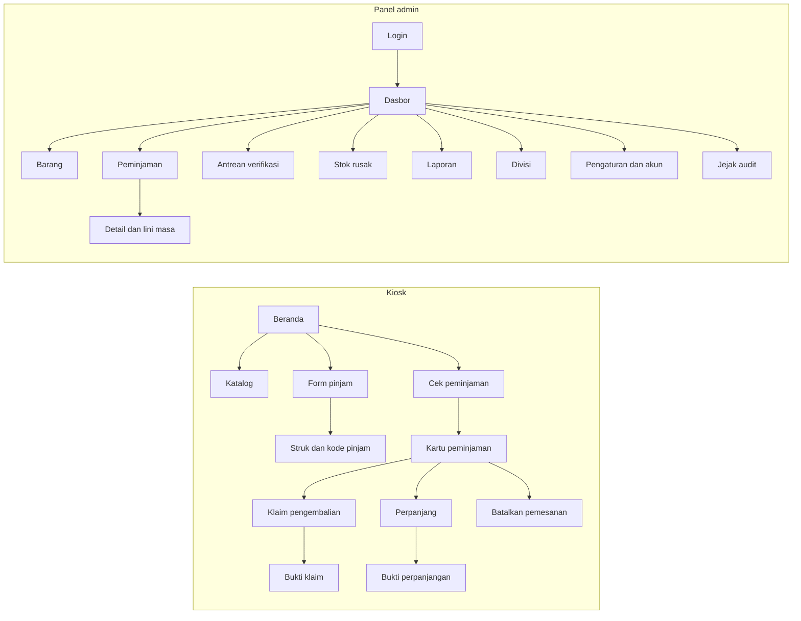

## 10. Contoh perhitungan

Barang **Kabel HDMI**, awalnya `total = 10`, `tersedia = 10`, `rusak = 0`. Batas awal peminjaman: Hari 7.

| Hari | Kejadian | total | tersedia | rusak | Dipinjam | Menunggu | Cek BR-01 |
|---|---|---|---|---|---|---|---|
| 0 | Budi meminjam 3 unit | 10 | 7 | 0 | 3 | 0 | 7+0+3+0 = 10 ✓ |
| 5 | Budi klaim 2 unit (baik) | 10 | 7 | 0 | 1 | 2 | 7+0+1+2 = 10 ✓ |
| 6 | Admin verifikasi: 1 baik, 1 rusak | 10 | 8 | 1 | 1 | 0 | 8+1+1+0 = 10 ✓ |
| 6 | Budi memperpanjang 3 hari | 10 | 8 | 1 | 1 | 0 | Batas baru Hari 10 (7 + 3) ✓ |
| 11 | Budi klaim 1 unit terakhir (baik), terlambat 1 hari | 10 | 8 | 1 | 0 | 1 | 8+1+0+1 = 10 ✓ |
| 12 | Admin verifikasi: hilang (catatan admin terisi) | 9 | 8 | 1 | 0 | 0 | 8+1+0+0 = 9 ✓ |
| 13 | Admin: 1 unit rusak selesai diperbaiki | 9 | 9 | 0 | 0 | 0 | 9+0+0+0 = 9 ✓ |

Hal yang diperlihatkan contoh ini: klaim Hari 5 tidak mengubah `tersedia` (D-1). Unit rusak Hari 6 tidak masuk `tersedia` sampai Hari 13 (D-2). Perpanjangan dihitung dari batas lama, bukan dari Hari 6. Keterlambatan 1 hari tercatat pada klaim Hari 11 dan tidak bertambah selama menunggu verifikasi hingga Hari 12 (D-8). Pada Hari 12 admin mengubah hasil dari "baik" yang dilaporkan menjadi "hilang", sehingga catatan admin wajib (BR-06).

**Variasi pemesanan.** Bila Budi memesan di Hari 0 untuk mulai Hari 3, `tersedia` sudah turun menjadi 7 sejak Hari 0 dan statusnya Dipesan sampai Hari 3. Bila ia membatalkan di Hari 2, `tersedia` kembali 10 dan statusnya Dibatalkan. Bila tidak dibatalkan, batas kembali dihitung dari Hari 3 (paling jauh Hari 10 dengan `maks_durasi_awal_hari = 7`), dan klaim baru boleh dibuat mulai Hari 3.

## 11. Migrasi dari prototipe SQLite ke MySQL (FR-S-03)

Skema prototipe belum terlihat, jadi langkah ini perlu disesuaikan setelah `server.js` dan `src/services/db.ts` diperiksa (task 0.2). Karena skema berubah **dan** mesin basis data berubah, migrasi dilakukan sekali jalan: skema v5 langsung dibuat di MySQL, lalu data dipindahkan dari SQLite. Tidak ada tahap antara "skema lama di MySQL".

1. **Backup** `database.sqlite` dan simpan di luar folder proyek. Berkas ini hanya dibaca oleh skrip migrasi, tidak pernah diubah.
2. **Latihan dulu.** Buat basis data `inventaris_it_trial` dari `0001_init.sql`, jalankan skrip `scripts/migrate-sqlite-to-mysql` ke sana, lalu verifikasi. Ulangi sampai bersih. Baru setelah itu jalankan ke `inventaris_it`.
3. Pemetaan (penulisan ke MySQL dilakukan dalam satu transaksi InnoDB per tahap: barang, divisi, kategori, peminjaman, klaim, buku besar):
   - Setiap peminjaman lama → satu `loans` dengan `kode_pinjam` baru. `batas_kembali_awal = batas_kembali`.
   - Nilai divisi yang semula teks bebas → baris `divisions`, satu per nilai unik **setelah admin menyatukan ejaan ganda** (misalnya "IT" dan "Teknologi Informasi"). Lalu `loans.division_id` diisi.
   - **Pemetaan `category` (kolom lama di prototipe) → `categories`.** Nilai unik kolom `category` dari tabel `items` lama dipetakan ke baris `categories`. Barang yang tidak punya `category` atau punya nilai kosong/NULL dimasukkan ke kategori sementara `"Tanpa Kategori"` yang dibuat oleh seed saat inisialisasi basis data agar invarian FK terpenuhi (`items.kategori_id` NOT NULL). Admin kemudian memindahkan barang-barang itu ke kategori yang benar secara manual setelah go-live.
   - **Pemetaan `condition` (kolom lama di prototipe) → kondisi turunan.** Nilai teks `condition` prototipe (`good`, `fair`, `bad`, `perlu_perbaikan`, atau nilai lain) **tidak dipindahkan** ke kolom mana pun; kondisi pada v5 adalah turunan dari angka stok (BR-29). Nilai `perlu_perbaikan` khususnya tidak bisa diterjemahkan ke angka unit tanpa hitung fisik. Seluruh nilai lama ini dicatat dalam **daftar periksa hitung fisik** (langkah 5) untuk dicocokkan dengan barang fisik.
   - **Pemetaan `borrower_type` atau nama serupa (kolom lama di prototipe) → `loans.tipe_peminjam`.** Jika ada kolom yang nilainya dapat dipetakan ke `'karyawan'` atau `'magang'` (label antarmuka Karyawan atau Magang), petakan. Jika tidak ada atau ambigu, isi `tipe_peminjam = 'karyawan'` sebagai nilai bawaan untuk semua peminjaman lama, dan catat di log migrasi agar admin dapat mengkoreksi bila perlu.
   - Setiap barang pada peminjaman lama → satu `loan_items`.
   - Peminjaman lama yang sudah dikembalikan → satu `return_claims` berstatus `diverifikasi` dengan satu baris per kondisi tercatat, dan hasil verifikasi diisi sama dengan kondisi tercatat.
   - Peminjaman lama yang masih aktif → tanpa klaim.
   - `items.total` dan `items.tersedia` dipindahkan apa adanya, `rusak = 0`.
   - Untuk setiap barang, buat satu baris `stock_movements` awal (`TAMBAH_STOK`) yang menyetel buku besar sama dengan nilai sekarang.
4. **Verifikasi:** jumlah peminjaman, total stok, dan status sebelum dan sesudah harus cocok (T-5.22), dan BR-01 benar untuk semua barang.
5. **Hitung fisik sekali.** Aturan lama memasukkan barang rusak ke `tersedia`, dan riwayat itu tidak bisa dipulihkan otomatis. Nilai lama `perlu_perbaikan` tidak punya padanan angka unit. Setelah migrasi, petugas menghitung fisik dan memindahkan unit rusak yang sebenarnya lewat penyesuaian dan alur stok rusak. **Daftar periksa hitung fisik** mencakup: (a) barang dengan kondisi lama `perlu_perbaikan` atau kondisi tak dikenal, (b) barang yang masuk kategori "Tanpa Kategori", (c) peminjaman dengan `tipe_peminjam` yang diisi default.
6. **Rencana mundur:** bila verifikasi gagal, kosongkan atau hapus basis data target. Prototipe SQLite tetap berjalan sampai migrasi final dinyatakan lulus. **Hari peralihan:** hentikan input di prototipe (di luar jam kerja), jalankan migrasi final pada data terbaru, verifikasi, baru nyalakan sistem baru. Data yang dimasukkan setelah latihan tidak ikut kecuali migrasi dijalankan ulang.

## 12. Catatan implementasi

- **Tipe tanggal.** Hitung selisih hari memakai tanggal kalender Asia/Jakarta, bukan selisih milidetik, agar pergantian jam tengah malam tidak memunculkan keterlambatan palsu.
- **Kode klaim dan kode pinjam** memakai pembangkit acak yang aman secara kriptografis (`crypto.randomInt`), bukan `Math.random`. Kode pinjam berformat `PJM-XXXXXX`, kode klaim berformat `KMB-XXXXXX`, keduanya memakai alfabet yang sama (BR-17).
- **Polling antrean.** Cukup satu permintaan ke `/api/admin/summary` setiap 30 detik. WebSocket tidak diperlukan pada skala ini.
- **Tes konkurensi.** Jalankan dua panggilan peminjaman paralel terhadap stok 1 dan pastikan tepat satu berhasil (T-5.21). Jalankan juga dua verifikasi paralel pada satu klaim dan pastikan satu mendapat 409.
- **Pemeriksaan kesehatan.** Saat server menyala, jalankan kueri invarian dari bagian 2.2 dan catat peringatan ke log bila ada selisih.
- **Tanpa proses terjadwal.** Status Dipesan dan Terlambat diturunkan dari perbandingan tanggal saat data dibaca, jadi tidak ada cron atau pekerjaan latar yang perlu dijaga tetap hidup.
- **Semua akses data asinkron.** `mysql2` bersifat async, berbeda dengan `better-sqlite3` yang sinkron. Seluruh kode layanan memakai `async/await`, dan SQL hanya hidup di `server/db/`, bukan di rute atau komponen, agar mesin basis data tetap bisa diganti di satu tempat.
- **Kode ke huruf besar.** Collation tidak membedakan huruf besar/kecil, tetapi tampilan dan struk tetap memakai huruf besar. Normalkan `kode_pinjam` dan `kode_klaim` dengan `toUpperCase()` saat dibuat dan saat dicari.
- **Pembacaan baris terdampak.** Gunakan `affectedRows` (bukan `changedRows`) saat memeriksa apakah pembaruan bersyarat berhasil.

## 13. Strategi dua sistem berdampingan

Selama pengembangan v5, prototipe SQLite tetap berjalan. Sistem baru dibangun **berdampingan**, bukan menggantikan secara serentak. Urutan besarnya:

1. **Login** (autentikasi server-side) — prototipe belum punya; sistem baru membangunnya pertama.
2. **Migrasi data** (skrip SQLite → MySQL) — dilatih berulang kali sebelum go-live.
3. **Satu port produksi** (Express menyajikan frontend build, berjalan sebagai layanan Windows yang menyala otomatis setelah PC hidup).
4. **Uji penerimaan** (SOP bersama petugas IT dan karyawan).

Prinsip berdampingan:

- Kode baru ditambahkan di modul baru (`server/db/`, rute `/api/*` baru). Kode prototipe di `server.js` lama **tidak diubah** kecuali task menyebutnya secara tegas.
- Data prototipe tetap di `database.sqlite` dan tidak tersentuh oleh migrasi latihan. Migrasi final ke `inventaris_it` baru dijalankan sekali setelah semua latihan lulus.
- Selama masa berdampingan, input data baru sebaiknya tetap ke prototipe, bukan ke sistem baru yang belum selesai, agar data yang dimigrasi saat go-live adalah data terkini.
